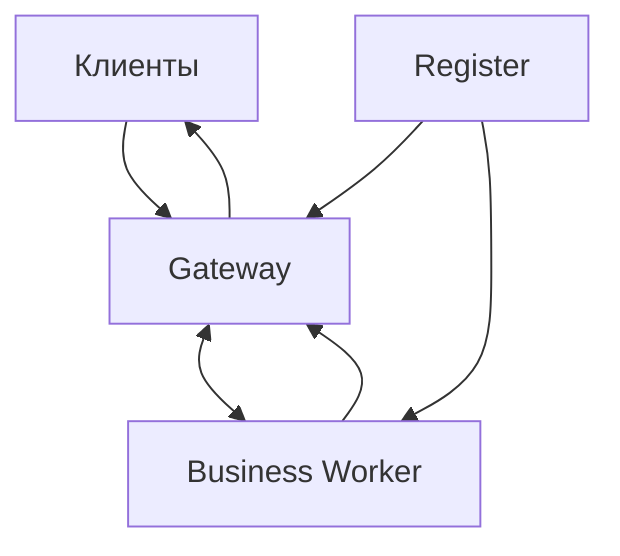

# Архитектура Cluster

Gateway принимает соединения и хранит локальную карту активных клиентов. Business Worker исполняет обработчики приложения и возвращает сообщения через служебный канал Gateway. Register координирует обнаружение узлов. Отказ Registry влияет на обновление топологии, а отказ Gateway разрывает обслуживаемые им клиентские подключения.

Состояние соединения локально Gateway. Горизонтальное масштабирование требует, чтобы маршрутизация идентификаторов, публикации адресов и клиентские повторы учитывали отказ узлов. Устойчивое хранение состояния и гарантированная доставка не входят в доказанные свойства пакета.
