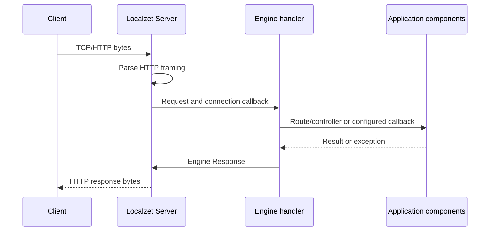

export const pageTitle = 'Архитектура и runtime Triangle Engine'
export const description = 'Границы Engine, Server, приложение Triangle, bootstrap-компоненты и Fiber-контекст.'

# Архитектура и runtime

Triangle Engine соединяет структуру приложения Triangle с runtime Localzet Server. Он дополняет сетевой сервер типами и механизмами приложения, но не заменяет транспорт или процессный supervisor.

## Поток запуска

```text
конфигурация приложения
        │
        ▼
support\App::run()
        │  localzet_start(...)
        ▼
Localzet Server: listener и worker lifecycle
        │
        ▼
HTTP protocol → Triangle\Engine\Request → обработчик приложения
        │
        ▼
Triangle\Engine\Response → Server connection send
```

`support\App::run()` собирает сервер из конфигурации и делегирует создание endpoint-ов helper-у Server. Обработчик, маршрутизация, middleware и контроллеры предоставляются подключёнными компонентами и самим приложением.

## Основные классы

- `Triangle\Engine\App` — абстрактная база обработчика, наследующая `localzet\ServerAbstract`. Приложение реализует callback-ы протокола и использует доступ к текущим request/connection через `Context`.
- `Triangle\Engine\Request` расширяет HTTP Request Server типами metadata приложения и преобразованием upload-ов в `Triangle\Engine\File`.
- `Triangle\Engine\Response` расширяет Server HTTP Response и хранит связанное исключение.
- `Triangle\Engine\Bootstrap::start(?Server $server = null)` вызывает базовые, проектные и plugin bootstrap-компоненты, если их классы доступны.
- `Triangle\Engine\Context` хранит состояние для активного PHP Fiber, Swoole coroutine, Swow coroutine или процесса; очистка выполняется через `Context::destroy()`.

## Изоляция контекста

Server 7 может выполнять обработчики в Fiber при разных event loop backend-ах. Ключ контекста Engine выбирается по фактической активной Fiber. Это позволяет двум чередующимся обработчикам сохранять отдельные данные. Код, который кладёт значение в контекст, должен очистить его на завершении операции, особенно если зарегистрировал callback через `Context::onDestroy()`.

Контекст — локальное состояние процесса и текущей coroutine/Fiber. Он не является общим хранилищем между worker-ами или узлами. Для разделяемого состояния используйте внешнее хранилище или явный межпроцессный механизм.

## Схема взаимодействия



Схема описывает границы компонентов. Она не гарантирует наличие конкретного router-а, middleware, exception policy или распределённого состояния в любом приложении.
