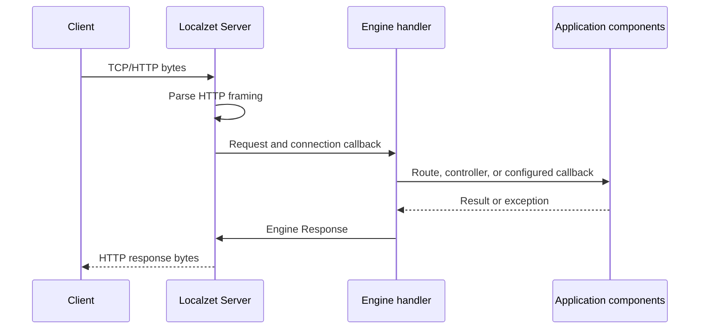

export const pageTitle = 'Triangle Engine architecture and runtime'
export const description = 'Runtime boundaries between Triangle Engine, Localzet Server, the application handler, and Fiber-local context.'

# Architecture and runtime

Triangle Engine connects Triangle application structure to the Localzet Server runtime. It adds application types and helpers without replacing the network transport or process supervisor.

## Startup and request flow

```text
application configuration
        │
        ▼
support\App::run()
        │  localzet_start(...)
        ▼
Localzet Server: listener and worker lifecycle
        │
        ▼
HTTP protocol → Triangle\Engine\Request → application handler
        │
        ▼
Triangle\Engine\Response → Server connection send
```

`support\App::run()` assembles endpoints from configuration and delegates their creation to Server helpers. The application or installed components supply the handler, routing, middleware, and controllers.

## Main classes

- `Triangle\Engine\App` is an abstract handler base extending `localzet\ServerAbstract`. Applications implement protocol callbacks and use `Context` to access the current request/connection.
- `Triangle\Engine\Request` extends the Server HTTP Request and wraps uploads as `Triangle\Engine\File` values.
- `Triangle\Engine\Response` extends the Server HTTP Response and stores an associated exception.
- `Triangle\Engine\Bootstrap::start(?Server $server = null)` runs available framework, application, and plugin bootstrap components.
- `Triangle\Engine\Context` stores values for the active PHP Fiber, Swoole coroutine, Swow coroutine, or process context.

## Context cleanup and isolation

Server 7 may run handlers through PHP Fibers on multiple event-loop backends. Engine keys Fiber context by the active Fiber so interleaved handlers do not share request state. Call `Context::destroy()` when the request or task finishes, particularly when callbacks were registered with `Context::onDestroy()`.

Context is local to a process and current Fiber/coroutine. It is not shared between worker processes or hosts. Use an external store or explicit IPC for shared state.

## Component sequence



The diagram shows component boundaries. It does not imply that every application includes a router, middleware, exception policy, or distributed state.
